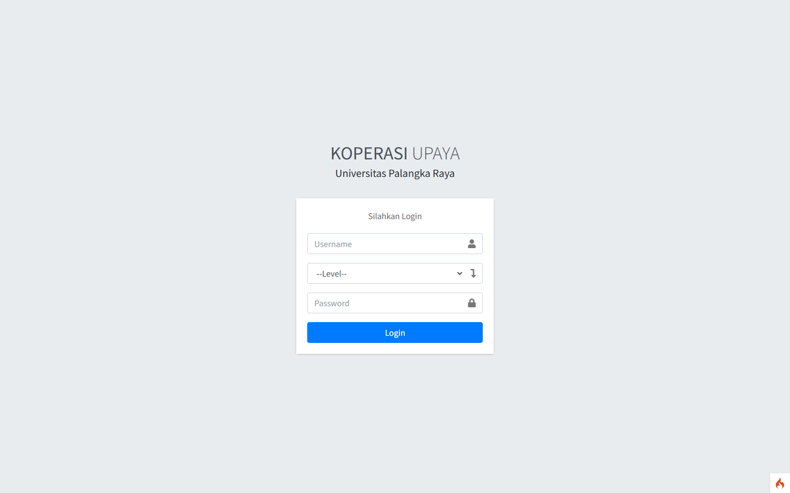
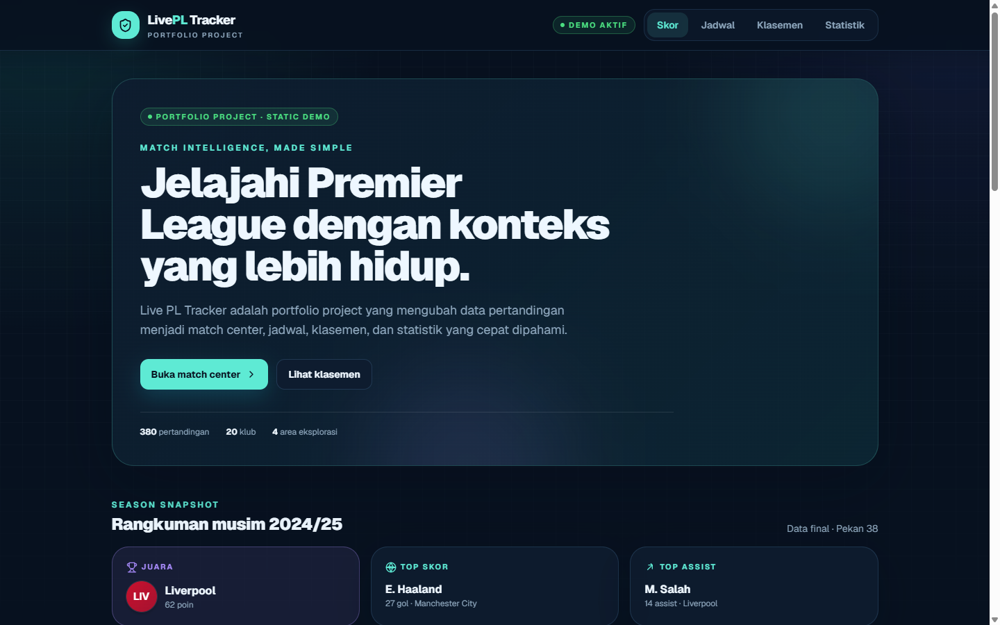
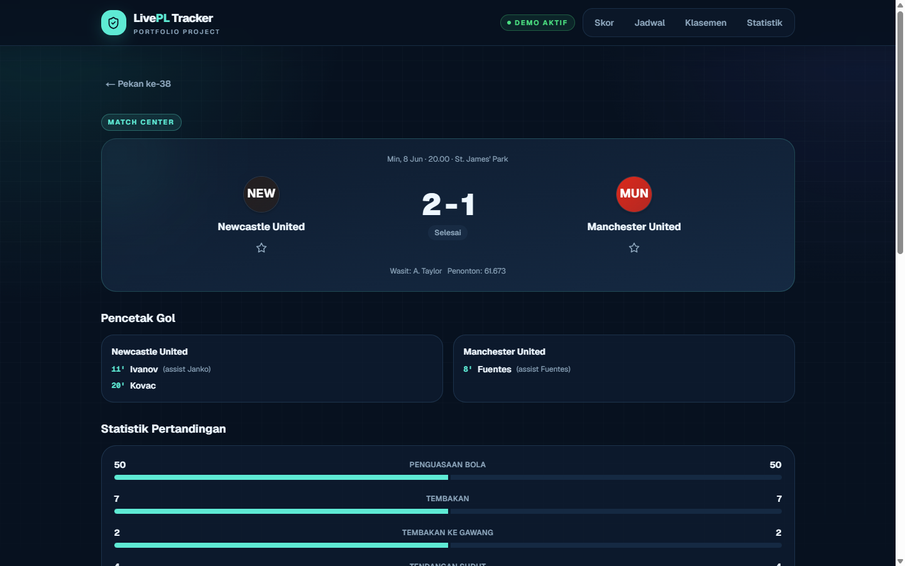
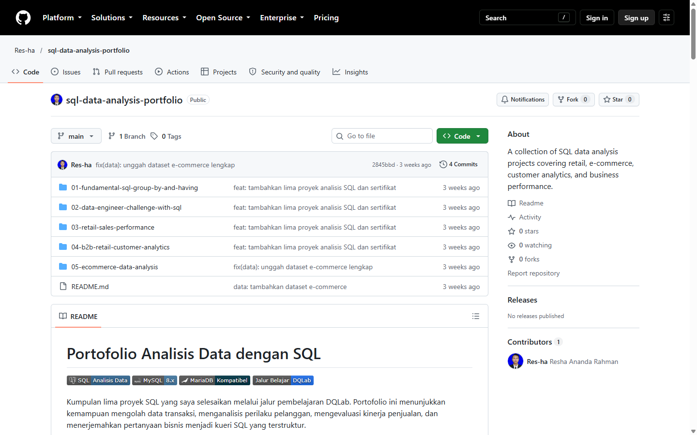

<!-- _class: lead -->
<!-- _paginate: false -->

Portofolio

# Pengembangan Web & Quality Assurance

Tiga proyek terpilih & bukti metodologi QA · github.com/Res-ha

**Resha Ananda Rahman**
S1 Teknik Informatika · Universitas Palangka Raya · IPK 3,62/4,00
Palangka Raya, Kalimantan Tengah

---

## Profil dan relevansi

**Pendidikan**
S1 Teknik Informatika
Universitas Palangka Raya
**IPK 3,62 / 4,00**

**Functional testing**
Uji fungsi lintas browser & device pada sistem yang saya bangun sendiri (Koperasi UPR), plus functional checks saat maintenance situs klien.

**Troubleshooting & dokumentasi**
Help desk Telkom: **10+ kendala harian**, dokumentasi status via Google Sheets, eskalasi error sistem, koordinasi follow-up.

**SQL & data**
5 proyek analisis data SQL (DQLab) + **5 sertifikat** — fondasi untuk validasi data dan pemeriksaan integritas.

---

## Pengalaman yang mendukung peran QA

**Junior WordPress Web Developer**
_Tingang.id_

- Development & maintenance situs klien
- **Bug fixes** dan penyesuaian konten/antarmuka
- **Functional checks** sebelum perubahan dirilis

**Intern — Web Developer**
_Koperasi Upaya UPR_

- Membangun sistem informasi berbasis web (PHP + CodeIgniter 4)
- **Functional testing lintas browser & device**
- Merancang struktur informasi yang mudah dinavigasi

**Provisioning & Migration Help Desk**
_PT Telkom Akses · Jul 2025 – Agu 2026_

- **10+** kendala order harian · **117** teknisi dalam koordinasi
- Dokumentasi status case, eskalasi error sistem
- Koordinasi follow-up: helpdesk–lapangan–sales–CSR

<strong>Pola kerja yang terbentuk:</strong> identifikasi masalah secara sistematis → dokumentasi yang jelas → memastikan setiap kasus mendapat follow-up.

---

## Bukti kemampuan QA

<h3>📝 Metodologi — dokumentasi QA</h3>

- **135 test case** dalam **14 suite** (`docs/testing/`)
- Format ID standar · kolom langkah & hasil harapkan
- Distribusi: **73 Positive · 42 Edge · 20 Negative**
- Coverage map: 12 fitur PRD → suite
- Template laporan bug (severity S1–S4, priority P1–P3)

<h3>🧪 Hasil pilot eksekusi — 7 Okt 2026</h3>

- **22 kasus** dieksekusi otomatis (suite Theme + Contact)
- **11 lulus · 1 gagal · 10 blocked · 0 error konsol**
- **2 laporan bug dibuat**, di antaranya:
  - **S2** — fitur form kontak tidak terimplementasi (komponen dead code, kontra PRD)
  - **S3** — default tema tidak mengikuti `prefers-color-scheme` sesuai PRD

<strong>Dokumen nyata:</strong> 14 file test case + 14 PDF + EXECUTION report + 2 bug report — siap direview di repository.

---

## Proyek 1 — Koperasi Upaya UPR Information System

2024Full-stackLIVE · koperasiupayaupr.org

Portal live Koperasi KPRI Upaya UPR

- **Overview:** website resmi Koperasi Upaya UPR — profil, layanan, dan informasi operasional bagi anggota, dengan struktur **MVC** yang memisahkan data, logika, dan presentasi.
- **Fitur:** profil organisasi · informasi layanan · konten mudah dikelola · layout responsif
- **Stack:** CodeIgniter 4 · PHP · MySQL

<strong>QA angle:</strong> functional testing di berbagai browser & device sebelum rilis; merancang struktur informasi yang mudah dinavigasi.

---

## Proyek 2 — Live PL Tracker

2026TypeScript · React · ViteLive demo

**Dashboard match center Premier League** — skor, jadwal, klasemen, dan statistik dalam pengalaman mobile-first.

01 <strong>Scores / Home</strong> snapshot musim & hasil

02 <strong>Schedule</strong> pekan 1–38, filter tim

03 <strong>Standings & Stats</strong> 20 klub, top skor/assist

04 <strong>Team & Profile</strong> favorit via localStorage

<strong>QA angle:</strong> state coverage lengkap — loading skeleton, not-found, focus-visible, reduced-motion.

---

## Live PL Tracker — Match Center

Detail pertandingan: skor, gol, statistik, lineup, timeline

38

Pekan pertandingan

20

Klub Premier League

2024/25

Data musim final

5

Area Match Center

**Challenge → Solusi**
Rate limit API Footbal → **mock data deterministik**: alur dapat direproduksi tanpa API key, tanpa login — ramah untuk review & pengujian.

---

## Proyek 3 — SQL Data Analysis Portfolio

5 proyekMySQL · MariaDB5 sertifikat DQLab

| #   | Proyek SQL               | Fokus                 |
| --- | ------------------------ | --------------------- |
| 1   | Fundamental SQL          | `GROUP BY`, `HAVING`  |
| 2   | Data Engineer Challenge  | Produk & transaksi    |
| 3   | Retail Sales Performance | Pendapatan & promosi  |
| 4   | B2B Customer Analytics   | Segmentasi pelanggan  |
| 5   | E-Commerce Analysis      | **30 kueri** analisis |

<strong>QA angle:</strong> SQL untuk <strong>validasi data</strong> — rekonstruksi angka dari tabel sumber, cek konsistensi hasil, dan menelusuri akar cause defect terkait data.

---

## Kemampuan untuk posisi Junior QA Engineer

**Functional testing**
Terbiasa memverifikasi fitur di browser & device berbeda, menyusun skenario positive/negative/edge, dan menjalankannya secara terstruktur.

**Identifikasi & dokumentasi defect**
Membuat 135 test case + 2 laporan bug lengkap dengan langkah reproduksi, severity, dan bukti — siap dikonsumsi developer.

**SQL & verifikasi data**
5 proyek analisis SQL — query untuk menelusuri inkonsistensi data saat menyelidiki akar cause sebuah defect.

**Kolaborasi dengan tim pengembangan**
Pengalaman kerja bersama helpdesk, teknisi, sales, CSR, dan klien — koordinasi lintas fungsi untuk menutup loop perbaikan.

<strong>Kejujuran & kesiapan:</strong> pengalaman profesional saya belum di role QA penuh — namun fondasi web development, functional testing, troubleshooting, dan SQL, ditambah dokumentasi QA yang saya susun sendiri, menjadi landasan kuat untuk belajar cepat dan berkontribusi bersama tim.

---

<!-- _class: lead -->
<!-- _paginate: false -->

Terima kasih

# Mari terhubung

**Kontak**
✉️ reshaanandarahman@gmail.com
🔗 linkedin.com/in/resha-ananda-rahman
💻 github.com/Res-ha
🌐 reshaananda-portfolio.vercel.app

**Proyek**
🤝 koperasiupayaupr.org
⚽ live-sports-tracker-zeta.vercel.app
🗄️ github.com/Res-ha/sql-data-analysis-portfolio

<strong>Resha Ananda Rahman</strong> · S1 Teknik Informatika · IPK 3,62/4,00 · Palangka Raya, Kalimantan Tengah

